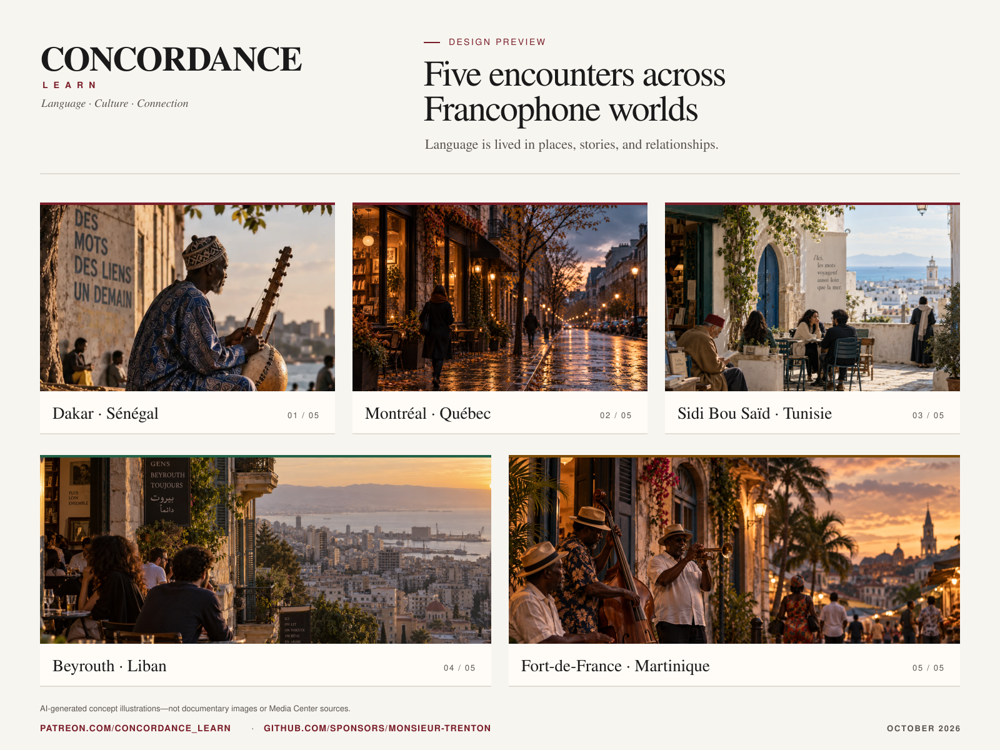

# Updates

Dated updates for sponsors and anyone following along, newest first. For the ongoing feature list (undated, always current), see **[ROADMAP.md](ROADMAP.md)**.

---

## Sponsor Update: October 28, 2026

### Finding your starting point and taking French beyond Concordance

Recent work on Concordance has focused on how learners begin, how they receive useful guidance, and how that guidance connects with the lives they lead beyond the platform.

The emerging first-time learner experience for the **Individual Learner Path, or ILP**, brings those questions together.

Someone arriving at Concordance may be beginning French, returning after years away, preparing for study or work, or following a cultural interest. The starting experience should acknowledge that context while being honest about what the platform can actually conclude.

Prior study and personal experience matter. They can help shape interests and choices. Understanding what someone has demonstrated, however, requires evidence. When that evidence is missing, Concordance should say “we don’t know yet” and offer a useful way to begin.

The ILP is intended to connect that understanding with meaningful opportunities: recommendations with understandable reasons, teacher-assigned work where applicable, and room for learners to pursue their own goals. The first-time interface is still taking shape, and connecting it carefully to the existing foundations remains ongoing work.

#### Learning continues when you leave the application

We have also made an important commitment explicit in Concordance’s public philosophy: **learning extends beyond Concordance**.

Imagine a learner spending time in Senegal, encountering French and Wolof in everyday life, and returning curious about Senegalese music, journalism, literature, or multilingual expression. Time away from the application may have opened an entirely new direction for learning.

Concordance should welcome that return. A break in platform activity should never, by itself, be treated as evidence that someone’s proficiency has declined.

Those new interests should eventually help guide discovery through the planned Media Center, with appropriately sourced and rights-governed resources. A learner’s account of an experience can inform what they want to explore; conclusions about demonstrated ability still need the governed evidence process.

The purpose is meaningful participation in languages and cultures. Concordance should help people become more independent participants in that world.

#### Making feedback useful

The redesign is developing the practical connections that support this purpose. Recent bounded rehearsal work has connected writing drafts, submissions, version-specific teacher comments, and revisions.

Teachers can offer holistic feedback, detailed passage comments, or both. Learners can revisit earlier feedback and understand which version it addressed. Contextual grammar and professional writing previews are also expanding opportunities to investigate meaning, consider an audience, and revise with a clear purpose.

The broader redesign and complete first-time ILP journey remain in development.

#### An infrastructure setback

Railway, the hosting service used for Concordance’s backend and development rehearsal, experienced a significant disruption associated with its October 21 security incident. Build and deployment interruptions affected the infrastructure Concordance depends on to put changes online for verification.

That disrupted the normal development workflow. Building around a teaching schedule means that lost deployment windows matter, even when work can continue elsewhere.

It also illustrates an easily overlooked part of an independent educational project: dependable hosting, careful verification, maintenance, and recovery work all require time alongside the visible features.

Your support helps sustain that work and the larger ambition behind it: understandable guidance, thoughtful teaching tools, learner independence, and closer engagement with living languages and cultures.

Thank you for helping Concordance grow carefully.

John

---

## Sponsor Update: October 18, 2026

### A clearer learning experience, with room for advanced communication

Concordance's website redesign is growing into a more connected experience for learners and teachers. Alongside clearer navigation, bilingual French and English interfaces, light and dark themes, and layouts designed for smaller screens, the work is expanding how learners investigate language, develop a response, receive feedback, and revise.

The goal is to make language study useful across a wider range of purposes: everyday exchange, cultural inquiry, sustained reading, study, and professional communication.

#### Improvements taking shape

- **Grammar through meaning and context.** Expanded practice connects forms to what a speaker or writer intends. Learners can compare interpretations, investigate a passage, consult optional explanations, and revise while retaining their work. The growing practice set includes pronoun reference, narrative time, hypotheses, and choices of mood and register.
- **A more coherent writing journey.** Writing, saved versions within the preview, feedback, and revision are connected more clearly. A new professional communication pilot links a fictional job advertisement, a tailored cover letter, an application email, and a changed follow-up request. The emphasis is on relevant detail, audience, register, and a clear purpose.
- **More useful teacher review.** Teachers can choose holistic, detailed, or combined feedback, comment on an exact word or passage, and compare a revision with the earlier text and feedback. Comments remain attached to the version reviewed, and unfinished annotations are preserved.
- **Clearer classroom organization.** Class overviews, assignment search and reuse, individual deadline extensions, and private follow-up notes are being brought into the same design system so teachers can move between an overview and the work that needs attention.

These interactions currently run in an isolated design preview using illustrative material and visit-local state. They are not yet a released, connected classroom service.

#### Expanding toward C1 (Advanced) communication

The redesign now includes initial activities proposed at CEFR C1, extending the experience beyond shorter, more constrained practice. The current pilots explore narrative viewpoint, shifts between past and present narration, and sustained reading of connected documents. Learners investigate who is speaking, how events relate, what a source actually supports, and how to reformulate meaning for a particular reader.

C1 is a communication goal, not a checklist of rare verb forms. The direction is toward more sustained interpretation and expression, greater precision, and thoughtful choices about audience, register, and perspective. Professional writing adds another practical setting for that broader ambition.

These are initial authored pilots with proposed teaching placements. They do not constitute a complete C1 curriculum, validate an attained learner level, or establish an ACTFL equivalence.

#### Plans for C2

A proposed catalogue also outlines future C2 work: interpreting ambiguity and implicit meaning; distinguishing a source's position from a writer's own commitment; reformulating dense information without losing nuance; and adapting language across conversation, professional writing, academic work, and documented Francophone varieties.

Those outlines still need detailed authoring, source review, activity development, and validation. Marked or literary forms are planned as optional contextual extensions, rather than a requirement to use unusual language in every situation. C2 remains planned work, with no release date promised.

The full redesign will move into production through the established Media Center, cleanup, and integration sequence. Throughout that work, Concordance's purpose remains meaningful participation in languages and cultures, supported by verifiable evidence, teacher judgment, and learner agency.

Support through [GitHub Sponsors](https://github.com/sponsors/monsieur-trenton) or [Patreon](https://www.patreon.com/Concordance_Learn) helps sustain the development time, infrastructure, accessibility work, and careful content review needed to turn these previews into dependable experiences.

---

## Sponsor Update: October 13, 2026

### Redesigning the learner experience without outrunning the architecture

Concordance has entered a new stage of its visual redesign.

Recent work has moved beyond public-page concepts into an isolated learner-facing preview. The emerging design includes bilingual French and English interfaces, light and dark themes, clearer navigation, responsive layouts, visible display settings, and a more coherent visual language across learning activities.

The redesign is intended to make Concordance feel like the platform it is becoming: a place for language, culture, investigation, reflection, and meaningful communication—not a conventional test-preparation application with a new coat of paint.

The preview now explores learner experiences for writing, reading, listening, grammar in context, cultural inquiry, place-based discovery, practice history, assignments, and self-review. The interface uses a restrained editorial system built around warm paper tones, burgundy actions, green contextual information, amber clues, and typography that distinguishes explanatory structure from longer-form language and cultural material.

This remains review work, not a production release. The redesign is being developed separately so that visual progress does not quietly change educational authority, evidence behavior, learner state, or the governed boundaries already established in LAOS. Screens shown during this stage are illustrative, and the preview does not represent a finished public learner experience.

The accompanying graphic brings together five visual studies representing Dakar, Montréal, Sidi Bou Saïd, Beirut, and Fort-de-France. They express a central idea behind Concordance: language is lived in places, stories, relationships, and communities.

#### A note about the images

These are AI-generated concept illustrations created to explore Concordance's visual direction. As an independently built project, Concordance does not yet have the budget to commission original photography or illustration across all the Francophone communities represented here. The images are clearly labeled and are not presented as documentary photographs, authentic cultural resources, or Media Center sources.

Saying that Concordance is not an AI learning product does not mean that AI can never be used as a production tool. It means that an opaque model should not decide what a learner knows, determine the learner's path, replace teacher judgment, or substitute generated material for genuine cultural encounters.

Concordance is designed to preserve verifiable evidence, transparent provenance, teacher authority, learner agency, and meaningful engagement with authentic language and culture. As support grows, one goal is to replace concept imagery with licensed or commissioned work from photographers and artists connected to the places represented.

That is one concrete example of what sponsorship can make possible.

Support also helps cover hosting, databases, accessibility, privacy, rights-conscious media infrastructure, and the careful engineering required to turn the existing Recommendation, Individual Learner Path, Experience Resolution, and Media Center foundations into dependable learner experiences.

Concordance can be supported through [GitHub Sponsors](https://github.com/sponsors/monsieur-trenton) or [Patreon](https://www.patreon.com/Concordance_Learn).

Sponsorship does not purchase influence over educational conclusions or privileged access to learner data. It creates room to continue building the next layer without compromising the principles underneath it.

---

## Sponsor Update: September 22, 2026

### A foundation for authentic media

Concordance has begun implementing the Media Center, the part of the platform intended to connect learners with authentic texts, audio, video, music, journalism, literature, visual art, photography, and other cultural resources. The first implementation slice has now been merged. It establishes governed identity and custody for exact media-resource revisions, along with tightly bounded database authority for that information.

That may sound removed from the experience a learner eventually sees, but it answers a basic question that has to come first: when Concordance refers to a cultural resource, how can the system know exactly which version it means and preserve that identity even if a source changes later? Authentic online material can be edited, replaced, removed, or placed under different terms. A dependable educational system needs more than a mutable link and a title.

This foundation is also part of keeping rights and provenance central rather than treating them as cleanup work. The broader Media Center architecture separates resource identity, source and rights evidence, present availability, and deliverability. It also preserves an educational distinction that matters to me as a teacher: a painting, song, interview, or article does not possess an intrinsic proficiency level. The linguistic demand belongs to the task, scaffold, or experience built around it. That is how authentic culture can become accessible to earlier-stage learners without pretending that the resource itself was written or created for them.

This is a real engineering milestone, but it is not a Media Center launch. Slice 1 does not admit an external provider, choose resources for learners, assign proficiency levels, evaluate current delivery rights, or open the authentic-media path. Public authentic-media delivery remains intentionally closed while those later authorities are designed, implemented, and verified. The work since the first implementation attempt has also strengthened database-role separation and release verification, but production activation remains a separate operational decision.

The next work is to build carefully on this foundation: governed source and rights evidence, explicit provider admission, deterministic selection, current availability and deliverability checks, and eventually learner-facing experiences with appropriate scaffolding. The goal is not simply to add more content. It is to make authentic language and culture available in a way that is educationally useful, technically accountable, and respectful of the people and institutions that created it.

GitHub Sponsors is now live for Concordance. Support helps cover hosting, databases, speech and language services, accessibility, privacy, and the sustained development time required for careful work like this. Sponsorship does not purchase influence over educational conclusions or access to learner data; it creates room to build the next layer without compromising the principles underneath it.

---

## Sponsor Update: September 5, 2026

### From learning opportunities to governed experiences

Over the past several weeks, Concordance has closed another important part of the path between understanding a learner and offering something useful to do next. The Individual Learner Path is now implemented and accepted through its intended architectural boundary, including the append-only interaction record that was still outstanding in the August 27 update. It can preserve the difference between a recommendation, teacher-required work, and a learner's own choice while recording dismissals or deferrals without turning them into judgments about motivation or proficiency.

The next downstream layer, Experience Resolution, is also implemented and accepted for the currently supported path. Its role is deliberately narrow: it takes a verified learning opportunity and resolves it into a specific, revision-bound experience that can be launched, while preserving the educational decision that produced it. Delivery availability cannot rewrite recommendation rank, substitute a different educational target, or quietly alter learner state. Historical resolution records can be verified, and failures stop at a governed boundary rather than falling through to an unrelated activity.

This is meaningful infrastructure, but it is not a claim that every kind of learner experience is now available. The current implementation supports Concordance's existing native practice path. Authentic media, broader activity families, grading, and the creation of new evidence remain separately governed work. The distinction is important: reaching a reliable backend boundary is progress, but it should not be presented as a finished learner-facing system.

Concordance has also accepted the architecture for a future Media Center. The decision treats texts, audio, video, music, journalism, literature, visual art, photography, and other cultural artifacts as first-class resources. It separates resource identity, provenance, rights, availability, and delivery from proficiency judgment. An artwork or recording is not assigned a learner level; the educational and linguistic demand belongs to the task, scaffold, or experience built around it.

Rights are part of the design from the beginning. The architecture requires retained policy evidence, explicit provider admission, current eligibility and availability checks, and a final current-deliverability gate before access can be issued. Architectural acceptance does not authorize implementation or admit any external provider. The authentic-media path remains intentionally unavailable until the Media Center is implemented and independently verified, so the platform cannot silently substitute an inappropriate resource merely to keep a request moving.

Taken together, these milestones extend Concordance's governed path from evidence to recommendations, individual learning opportunities, and now bounded experience resolution. The work remains grounded in the same principle: educational technology should make its decisions inspectable, preserve teacher judgment and learner agency, and be honest about the difference between a sound foundation and a finished experience.

---

## Sponsor Update: August 27, 2026

### The Individual Learner Path reaches a major milestone

Concordance has reached an important milestone in the Individual Learner Path, or ILP. The Recommendation Engine runtime and the foundational ILP runtime now exist, which means the system has moved beyond describing how evidence-informed individualization should work and into an implemented, governed path from learner evidence to meaningful learning opportunities.

The distinction matters because the goal is not simply "personalized learning." Concordance is not being designed to predict how quickly someone ought to learn, penalize a learner for taking more time, or construct a compulsory sequence that an algorithm expects everyone to follow. Learners bring different histories, interests, goals, and needs to a language. Their pace belongs to them. The ILP is designed to preserve that principle while still making educational evidence useful.

At a high level, LAOS now connects evidence assertions, canonical learner state, independent framework projections, recommendations, and individual learning opportunities through bounded layers. A recommendation remains a recommendation rather than silently becoming educational truth or required work. Teacher-required work remains authoritative and structurally distinct. Learner choices remain choices rather than becoming hidden proficiency judgments. Historical educational decisions are preserved so they can be inspected and verified rather than quietly reconstructed according to whatever model or policy happens to be current.

Privacy is part of this architecture as well. Individualized learning can become invasive when every click, hesitation, skipped activity, or absence is treated as a signal about motivation or ability. Concordance is taking a different approach. Dismissing or deferring an opportunity does not reduce proficiency, and ordinary platform behavior should not become educational evidence merely because it can be collected. The broader principle is that possessing information does not mean every part of the system is entitled to use it. Individualization should not require surveillance.

This milestone does not mean the complete learner-facing ILP experience is finished. A bounded append-only interaction obligation remains within the accepted ILP boundary, and the next major questions concern how individual opportunities connect to actual experiences. Concrete activity selection, launch mechanics, media delivery, grading, and new evidence remain downstream rather than being folded into ILP.

That downstream work is increasingly connected to the Media Center. Concordance is being designed so authentic culture is not reserved for advanced learners. Texts, audio, video, visual art, photographs, and other cultural artifacts can be accessible to learners at different stages when the task around them is appropriately scaffolded. The resource itself does not have a proficiency level. The linguistic and educational demand placed on the learner does.

This is the kind of progress that is difficult to show in a screenshot but matters enormously to what Concordance can become. The objective is not to keep learners busy. It is to build technology that can reason carefully from evidence, respect teacher judgment, preserve learner agency and privacy, and help people become more capable communicators and more independent participants in multilingual and multicultural communities.

---

## Sponsor Update: August 2026

### From learner evidence to future guidance

Concordance reached an important foundation milestone in the architecture connecting learner performance to future instructional guidance. Meaningful performance can contribute evidence, evidence can inform an auditable understanding of demonstrated ability, that understanding can be viewed through independent proficiency frameworks, and a recommendation layer can identify valuable opportunities to consider next.

This matters because individualized learning should not emerge from an opaque AI decision. The design keeps educational truth, framework interpretation, and instructional guidance distinct. It supports traceable rationale, reproducible processing, and teacher oversight while leaving room for learner goals, learner choice, and learner pace. AI can assist within those boundaries; it does not become the educational authority.

Since this update was written, the Recommendation Engine runtime and foundational Individual Learner Path runtime have been implemented. See the August 27 update above for the current state.

---

## Sponsor Update: Late July 2026

The best language-learning tools do more than add activities. They help students notice what is difficult, understand why it is difficult, and know what to do next. This month, Concordance moved further in that direction.

### Practice for the parts of French that usually get skipped

Students can now work directly on two areas that are easy to recognize but hard to truly master.

**Faux Amis** gives students focused practice with French words that resemble English words but carry a different meaning. These mistakes are especially persistent because the student often feels confident while being wrong. Targeted contrast practice helps learners slow down, notice the difference, and build a more reliable connection between the French word and its meaning.

**Pronoun Transformation** asks students to rebuild sentences using the correct French pronouns and word order. This gives learners practice with a structure they must produce, not simply identify. It is particularly valuable because pronoun placement is one of the areas where a student can understand a rule in isolation but still struggle to use it in a real sentence.

Sentence Builder has also expanded with new material covering agreement, connectors, conjugation, politeness, and relative and object pronouns. Students must make decisions about how a sentence works, then receive feedback tied to the underlying concept. That makes an incorrect answer useful. It shows both the learner and the teacher what needs attention next.

This is the kind of work sponsorship makes possible: building the less glamorous parts of a curriculum carefully, because those are often the parts that determine whether a student can actually use the language.

### A clearer path from feedback to progress

Concordance now gives students a more useful picture of the patterns behind their mistakes. The new Focus Areas space turns recurring errors into a clear set of priorities, with direct paths into the grammar explanations and practice that address them.

For learners, this changes practice from a series of disconnected corrections into a plan. Instead of wondering why the same kind of mistake keeps returning, a student can see the concept involved and choose a concrete way to work on it. Teachers gain the same visibility, so support can be targeted before frustration becomes disengagement.

Writing and speaking practice have also been refined so feedback leads naturally to another attempt. A score is useful, but the real value is knowing what to work on next and having a manageable next step.

### Advanced French as a living conversation

The C1 Translanguaging Hub has grown into a richer space for working with Francophone texts, regional language, translation choices, and cultural context.

At an advanced level, students need more than another vocabulary list. They need to explore how meaning changes across registers, regions, histories, and languages. The hub gives them a guided place to do that while continuing to develop precise French, cultural awareness, and confidence with authentic language.

This matters because advanced proficiency is not only the ability to produce grammatically correct sentences. It is also the ability to interpret what someone means, recognize how language reflects identity and context, and make thoughtful choices about how to respond.

### What comes next

We are continuing to deepen the newest practice areas and make each student's path through Concordance clearer and more reliable.

Thank you for supporting a platform built around demonstrated proficiency rather than the appearance of progress. Sponsorship helps make room for the careful, sustained work required to build something students and teachers can genuinely depend on.

---

## Sponsor Update: July 2026

A lot has happened behind the scenes since the last update, and it's worth sharing with the people actually making this possible.

### A safety net for AI conversations that still gives beginners the benefit of the doubt

Concordance's AI conversation partner lets students practice French with a patient speaker that's available when they need it. As these conversations become a bigger part of the classroom, the platform includes automated content review that can flag concerning content for teacher and school-administrator review.

Two things set this apart from the blunt content filters bolted onto most AI products. First, nothing ever happens to a student automatically: the system only surfaces a flag for a human to look at and judge. It informs; it never punishes. Second, and this matters enormously for a language-learning tool, it is built to tell the difference between misuse and a beginner. Broken grammar, blunt phrasing, and simple halting sentences are exactly what learning a language looks like, and the system is deliberately designed to ignore them. A student struggling to form a sentence is never mistaken for a problem.

Teachers are intended to see only the students within their authorized context, and the workflow is designed to give staff visibility without turning the classroom into a surveillance operation. The governing principle is human review, privacy by default, and the benefit of the doubt for people who are here to learn.

### A real proficiency gate, not just a progress bar

Students on Concordance no longer advance to the next level just by racking up correct answers over time. A new capstone evaluation system now checks four things before anyone moves up: sustained grammar mastery, enough practice volume, genuine vocabulary retention, and a real one-sitting checkpoint testing the skills the next level actually needs. Teachers can see exactly where each student stands and choose when a capstone happens, rather than the platform deciding on its own.

This is a deliberate bet against how most language apps work. Streaks and points are easy to fake your way past. Demonstrated proficiency is not.

### Updated for the redesigned AP French context

College Board is changing the AP French Language and Culture context for the 2026–27 school year. Concordance has updated its AP-oriented vocabulary and taxonomy work to reflect the published redesign, including new task types and restructured themes. This is preparation support, not College Board affiliation or official examination authority.

### Quieter, but no less important: real hardening

A handful of real bugs got found and fixed this cycle, the kind that matter even though they don't make headlines: a mobile display issue affecting several screens, a teacher dashboard that could go blank on certain data, and an admin safety guard that now makes sure anyone previewing a student's account can only look, never accidentally change something. None of these were show-stopping, but all of them were worth fixing properly rather than patching around.

### What's next

Filling out the newest AP-oriented content areas with more practice material, and continuing to build toward a fuller picture of student progress for teachers. Thank you, as always, for backing something built to be useful, accountable, and dependable rather than merely finished-looking.
